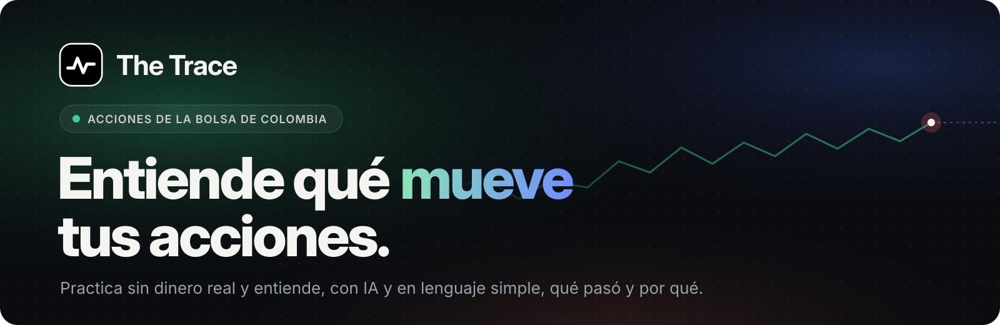
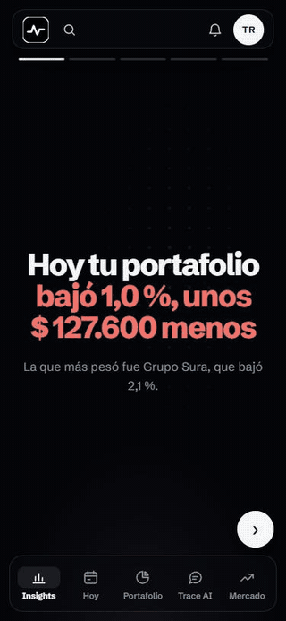
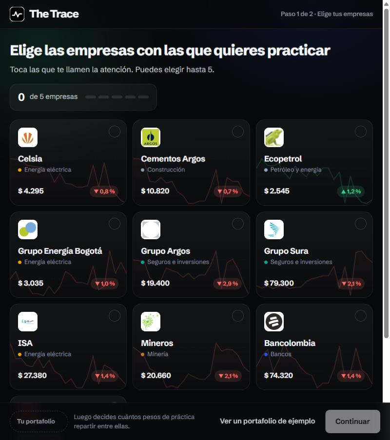
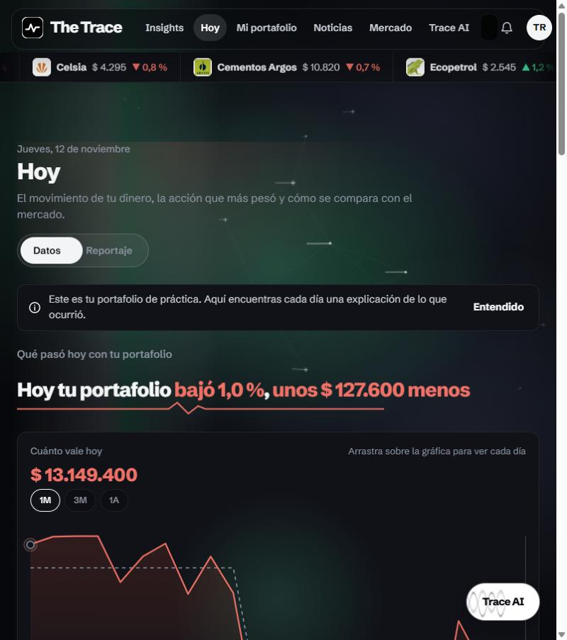
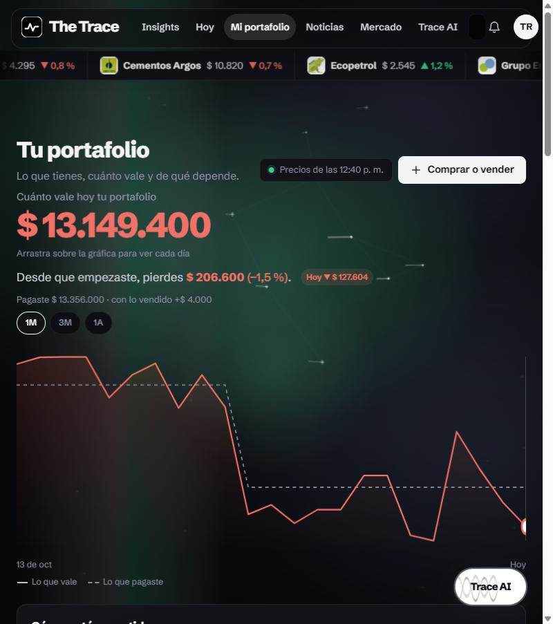
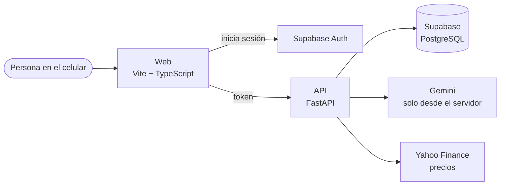

<a href="https://traceweb.onrender.com"></a>

<p align="center">
  <a href="https://traceweb.onrender.com"></a>
  <a href="https://github.com/jdrodriguez03/the-trace/actions/workflows/ci.yml"></a>
  <a href="LICENSE"></a>
</p>

<p align="center">
  
  
  
  
  
  
  
  
</p>

<p align="center">
  <a href="#qué-es">Qué es</a> ·
  <a href="#qué-puedes-hacer">Qué puedes hacer</a> ·
  <a href="#cómo-funciona">Cómo funciona</a> ·
  <a href="#correr-en-tu-computador">Correr en tu computador</a> ·
  <a href="#equipo">Equipo</a>
</p>

<p align="center">
  
</p>

> [!IMPORTANT]
> **The Trace informa, no recomienda.** Ningún texto, pantalla o respuesta de la IA sugiere comprar, vender o mantener una acción. Si le preguntas «¿compro Ecopetrol?», te explica qué la mueve y deja la decisión en ti.

## Qué es

The Trace es una app web, pensada primero para el celular, para que principiantes en Colombia practiquen con un portafolio de acciones colombianas **sin dinero real**.

Cada día te dice, en una frase corta, qué pasó con tu portafolio y por qué. Con IA y en lenguaje simple, sin jerga y en pesos colombianos.

**Estado:** MVP presentado el 10 de noviembre de 2026 y probado con personas reales. Sigue en desarrollo.

## Qué puedes hacer

| | |
| --- | --- |
| **Entrar sin fricción** | Como invitado, sin correo, o con tu correo para guardar tu portafolio. |
| **Armar un portafolio de práctica** | Con acciones de la Bolsa de Colombia, a precios actuales (con unos 15 minutos de retraso). |
| **Comprar y vender de práctica** | Ves tu costo promedio y cuánto ganas o pierdes, por acción y en total. |
| **Entender tu día** | *Hoy* te dice cuánto se movió tu dinero, qué acción pesó más y por qué. |
| **Ver gráficas** | El historial de cada acción y de tu portafolio, frente a lo que pagaste. |
| **Preguntarle a Trace AI** | Un chat que conoce tus acciones y explica lo que pasó, sin recomendar. |
| **Seguir las noticias que te afectan** | Ordenadas según cuánto pesa cada acción en tu dinero. |
| **Mirar el mercado colombiano** | Qué subió, qué bajó y cómo le fue al COLCAP. |

<details>
<summary><b>Capturas en el computador</b></summary>
<br>

| Portada | Elige tus empresas |
| --- | --- |
|  |  |
| **Hoy** | **Tu portafolio** |
|  |  |

</details>

## Cómo funciona



- **La web solo dibuja.** Pide todo a la API con el token de sesión de Supabase.
- **La API hace los cálculos en Python** (costo promedio, ganancia o pérdida, historial, qué pasó hoy) y solo deja ver y cambiar lo propio.
- **La IA se llama solo desde el servidor.** La clave nunca llega al navegador.
- **Los precios** se piden cada 15 minutos en horario de bolsa, y solo cuando alguien usa la app. Si fallan, la app muestra el último precio guardado con su hora.

### Lo que cuidamos

| Riesgo | Cómo se resuelve |
| --- | --- |
| Que la IA recomiende | Un filtro revisa cada respuesta. Si dice «compra», «vende», «deberías» o algo parecido, se cambia por una explicación de respaldo. |
| Datos personales | A la IA nunca se le envían nombre ni correo. |
| Gastos de IA | Cada persona tiene un límite de usos al día, y las respuestas se guardan 6 horas. |
| Que alguien vea lo de otro | Cada ruta revisa el token, y hay pruebas de que un usuario no puede tocar lo de otro. |
| Claves en el código | `gitleaks` revisa cada cambio en el CI. |
| Precios caídos | Último precio guardado y carga de respaldo desde un CSV. |

## Stack

| Pieza | Herramienta |
| --- | --- |
| API | Python 3.12, FastAPI, Pydantic, SQLModel, Alembic, uv |
| Base de datos y login | Supabase (PostgreSQL + Auth) |
| Web | Vite + TypeScript ([ADR-0006](docs/adr/0006-web-con-el-prototipo.md)) |
| IA | Gemini, con `google-genai` |
| Precios | Yahoo Finance con `yfinance`, con CSV de respaldo |
| Hosting | Render: la web como sitio estático y la API como servicio ([`render.yaml`](render.yaml)) |
| Calidad | GitHub Actions con ruff, pytest (más de 150 pruebas), ESLint, build y gitleaks |

Las decisiones de arquitectura están en [`docs/adr/`](docs/adr/).

## Correr en tu computador

Necesitas Git, Node.js 24 y [uv](https://docs.astral.sh/uv/).

> [!TIP]
> **¿Solo quieres verla?** La web tiene un modo demo que no necesita claves:
> ```bash
> cp web/.env.example web/.env.local     # trae VITE_USE_MOCKS=true
> cd web && npm install && npm run dev   # http://localhost:5173
> ```

<details>
<summary><b>La app completa, con tu propia base y tu propia IA</b></summary>
<br>

1. **Crea un proyecto en [Supabase](https://supabase.com).** En **Authentication → Sign In / Providers**, activa *Allow anonymous sign-ins* y el correo con enlace mágico. Copia la URL del proyecto, la llave publicable y la cadena de conexión **Session pooler**.
2. **Crea una clave de Gemini** en [Google AI Studio](https://aistudio.google.com/), con un límite de gasto mensual.
3. **Llena las variables:**
   ```bash
   cp api/.env.example api/.env           # DATABASE_URL, SUPABASE_URL, GEMINI_API_KEY, GEMINI_MODEL
   cp web/.env.example web/.env.local     # VITE_USE_MOCKS=false y las VITE_SUPABASE_*
   ```
4. **Prepara la base y arranca la API:**
   ```bash
   cd api
   uv sync
   uv run alembic upgrade head                   # crea las tablas
   uv run python -m scripts.seed_db              # carga las acciones del catálogo
   uv run python -m scripts.backfill_prices      # baja un año de precios para las gráficas
   uv run fastapi dev app/main.py                # http://localhost:8000/docs
   ```
5. **Arranca la web** en otra terminal: `cd web && npm install && npm run dev`.

> [!WARNING]
> Todo lo que empieza por `VITE_` termina dentro de la app y cualquiera lo puede leer. Nunca pongas ahí una clave secreta.

**Datos de respaldo:**
- Precios: `uv run python -m scripts.load_prices precios.csv` (hay un ejemplo en [`api/scripts/ejemplos/`](api/scripts/ejemplos/)).
- Noticias: `uv run python -m scripts.load_news noticias.csv`.

Antes de subir cambios, corre `bash check.sh` desde la raíz. Hace lo mismo que el CI.

</details>

> [!NOTE]
> **Sobre los precios.** Yahoo Finance es gratis y no pide clave, pero no es un servicio oficial y sus condiciones no permiten uso comercial. Por eso la API lee los precios a través de una interfaz en [`api/app/providers/`](api/app/providers/). Pasar a un proveedor con licencia es escribir un archivo nuevo ahí, sin tocar el resto de la app.

## Estructura

```
the-trace/
├─ api/            API en Python
│  ├─ app/
│  │  ├─ routes/      una ruta por recurso: portafolio, mercado, hoy, noticias, IA
│  │  ├─ core/        cálculos puros, todos con pruebas
│  │  ├─ ai/          Gemini, prompts, filtro, cuota y caché
│  │  ├─ providers/   de dónde salen los precios
│  │  └─ content/     catálogo y textos del servidor
│  ├─ migrations/     historial de la base (Alembic)
│  ├─ scripts/        cargar datos a mano
│  └─ tests/
├─ web/            app web, primero para el celular
├─ docs/
│  ├─ adr/            decisiones de arquitectura
│  └─ prototype/      prototipo de referencia
└─ .github/        CI y plantillas
```

## Lo que sigue

- [ ] Proveedor de precios con licencia y en tiempo real.
- [ ] Noticias automáticas, con un radar hecho con IA.
- [ ] Entornos separados de pruebas y producción.
- [ ] Pruebas de punta a punta.
- [ ] Revisión legal antes de abrir al público general.

## Equipo

- Julián David Rodríguez ([@jdrodriguez03](https://github.com/jdrodriguez03))
- Juan Triana ([@agarslok](https://github.com/agarslok))
- Isabela ([@isabellapensamiento-data](https://github.com/isabellapensamiento-data))
- Claude ([@claude](https://github.com/claude)), asistente de IA usado en el desarrollo

## Licencia

Copyright © 2026 Julián David Rodríguez. **Todos los derechos reservados.** El código es público solo para consulta: no se puede copiar, modificar ni usar sin permiso por escrito. Ver [LICENSE](LICENSE).

---

<p align="center"><sub>The Trace es un proyecto educativo con portafolios de práctica. No es una plataforma de inversión ni ofrece asesoría financiera.</sub></p>
