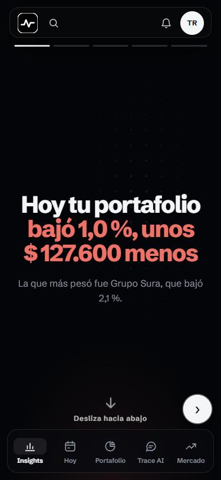
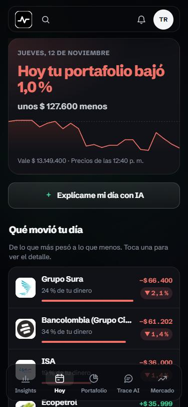
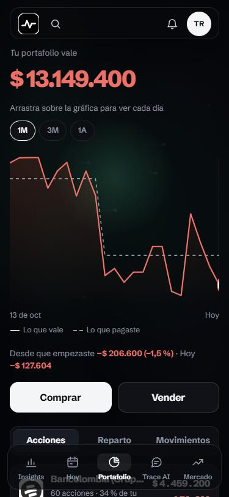
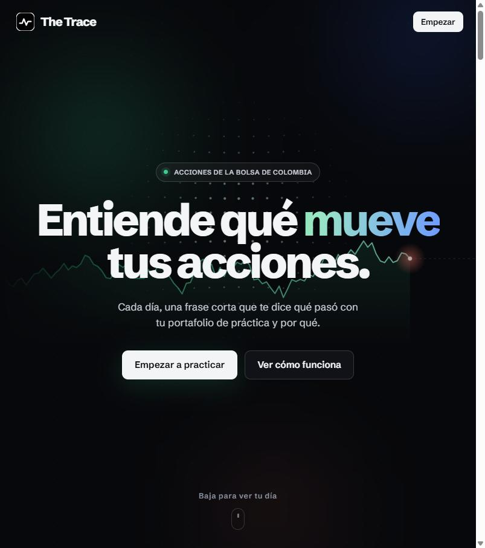

# The Trace

**Entiende qué mueve tus acciones.**

[](https://github.com/jdrodriguez03/the-trace/actions/workflows/ci.yml)

The Trace es una app web, pensada primero para el celular, para que principiantes en Colombia practiquen con un portafolio de acciones colombianas sin dinero real. Con IA y en lenguaje simple, explica qué pasó con su portafolio y por qué.

> **The Trace informa, no recomienda.** Ningún texto, pantalla o respuesta de la IA sugiere comprar, vender o mantener una acción.

**Pruébala:** [traceweb.onrender.com](https://traceweb.onrender.com). Puedes entrar sin correo, como invitado.

<p align="center">
  
  
  
</p>

<details>
<summary>Más capturas (computador)</summary>

| Portada | Elige tus empresas |
| --- | --- |
|  |  |
| **Hoy** | **Tu portafolio** |
|  |  |

</details>

**Estado:** MVP presentado el 10 de noviembre de 2026. Sigue en desarrollo.

## Qué hace

- **Entrar sin fricción:** como invitado o con un enlace mágico al correo.
- **Portafolio de práctica:** acciones de la Bolsa de Colombia a precios actuales, con unos 15 minutos de retraso.
- **Compras y ventas de práctica:** costo promedio y ganancia o pérdida, por acción y en total.
- **Hoy:** qué pasó con tu portafolio y por qué. Trae una explicación de respaldo y otra con IA.
- **Gráficas:** el historial de cada acción y de tu portafolio.
- **Trace AI:** un chat y una lectura de tu portafolio, que explican sin recomendar.
- **Noticias que te afectan:** ordenadas según cuánto pesan en tu dinero.
- **Mercado colombiano:** las acciones del catálogo y el COLCAP.
- **App instalable:** se agrega a la pantalla de inicio del celular.

## Cómo funciona

```
Navegador (web/)  ──token──▶  API (api/)  ──▶  Supabase (PostgreSQL)
      │                          ├──▶  Gemini (solo desde el servidor)
      └──▶ Supabase Auth          └──▶  Yahoo Finance (precios)
```

- **La web** solo dibuja. Pide todo a la API con el token de sesión de Supabase.
- **La API** revisa el token y solo deja ver y cambiar lo propio. Hace todos los cálculos en Python.
- **La IA** se llama solo desde el servidor. Nunca recibe nombre ni correo. Un filtro revisa cada respuesta: si recomienda algo, se cambia por la explicación de respaldo.
- **Los precios** se piden a Yahoo Finance cada 15 minutos en horario de bolsa, y solo cuando alguien usa la app. Si Yahoo falla, la app muestra el último precio guardado con su hora.

## Stack

| Pieza | Herramienta |
| --- | --- |
| API | Python 3.12, FastAPI, Pydantic, SQLModel, Alembic, uv, ruff, pytest |
| Base de datos y login | Supabase (PostgreSQL + Auth) |
| Web | Vite + TypeScript, con las pantallas del prototipo aprobado ([ADR-0006](docs/adr/0006-web-con-el-prototipo.md)) |
| IA | Gemini, con `google-genai` |
| Precios | Yahoo Finance con `yfinance`, con CSV de respaldo |
| Hosting | Render: la web como sitio estático y la API como servicio ([`render.yaml`](render.yaml)) |
| Calidad | GitHub Actions (ruff, pytest, lint, build y gitleaks), Sentry y PostHog |

Las decisiones de arquitectura están en [`docs/adr/`](docs/adr/).

## Correr en tu computador

Necesitas Git, Node.js 24 y [uv](https://docs.astral.sh/uv/).

### Solo la web, en modo demo

No necesita claves: usa los datos del prototipo.

```bash
cp web/.env.example web/.env.local     # trae VITE_USE_MOCKS=true
cd web && npm install && npm run dev   # http://localhost:5173
```

### La app completa

1. **Crea un proyecto en [Supabase](https://supabase.com).** En **Authentication → Sign In / Providers**, activa *Allow anonymous sign-ins* y el correo con enlace mágico. Copia la URL del proyecto, la llave publicable y la cadena de conexión **Session pooler**.
2. **Crea una clave de Gemini** en [Google AI Studio](https://aistudio.google.com/), con un límite de gasto mensual.
3. **Llena las variables:**
   ```bash
   cp api/.env.example api/.env           # DATABASE_URL, SUPABASE_URL, GEMINI_API_KEY, GEMINI_MODEL
   cp web/.env.example web/.env.local     # VITE_USE_MOCKS=false y las VITE_SUPABASE_*
   ```
   Todo lo que empieza por `VITE_` termina dentro de la app y cualquiera lo puede leer. Nunca pongas ahí una clave secreta.
4. **Prepara la base y arranca la API:**
   ```bash
   cd api
   uv sync
   uv run alembic upgrade head                   # crea las tablas
   uv run python -m scripts.seed_db              # carga las acciones del catálogo
   uv run python -m scripts.backfill_prices      # baja un año de precios para las gráficas
   uv run fastapi dev app/main.py                # http://localhost:8000/docs
   ```
5. **Arranca la web** en otra terminal: `cd web && npm install && npm run dev`.

Antes de subir cambios, corre `bash check.sh` desde la raíz. Hace lo mismo que el CI.

### Datos de respaldo

- **Precios:** si Yahoo falla, `uv run python -m scripts.load_prices precios.csv` carga precios desde un CSV (hay un ejemplo en [`api/scripts/ejemplos/`](api/scripts/ejemplos/)).
- **Noticias:** se cargan con `uv run python -m scripts.load_news noticias.csv`.

## Sobre los precios

Yahoo Finance es gratis y no pide clave, pero no es un servicio oficial y sus condiciones no permiten uso comercial. Por eso el código lee los precios a través de una interfaz en [`api/app/providers/`](api/app/providers/). Pasar a un proveedor con licencia es escribir un archivo nuevo ahí, sin tocar el resto de la app.

## Estructura

```
the-trace/
├─ api/        API en Python: rutas, cálculos, precios, IA y scripts de datos
├─ web/        App web, primero para el celular
├─ docs/
│  ├─ adr/        decisiones de arquitectura
│  └─ prototype/  prototipo de referencia
├─ sandbox/    visor para probar la API en local (no es parte de la app)
└─ .github/    CI, dueños por carpeta y plantilla de PR
```

Cada carpeta tiene un `README.md` que explica qué va adentro.

## Equipo

- Julián David Rodríguez ([@jdrodriguez03](https://github.com/jdrodriguez03))
- Juan Triana ([@agarslok](https://github.com/agarslok))
- Isabela ([@isabellapensamiento-data](https://github.com/isabellapensamiento-data))

## Licencia

Copyright © 2026 Julián David Rodríguez. **Todos los derechos reservados.** El código es público solo para consulta: no se puede copiar, modificar ni usar sin permiso por escrito. Ver [LICENSE](LICENSE).

---

The Trace es un proyecto educativo con portafolios de práctica. No es una plataforma de inversión ni ofrece asesoría financiera.
